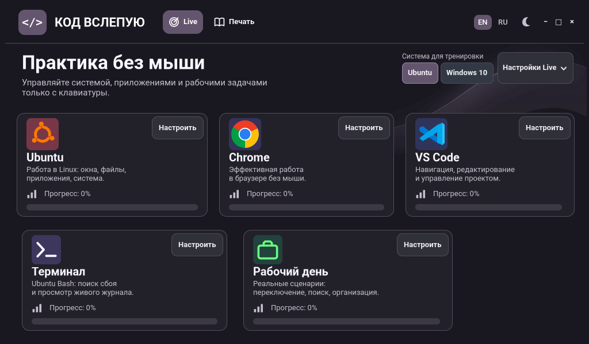
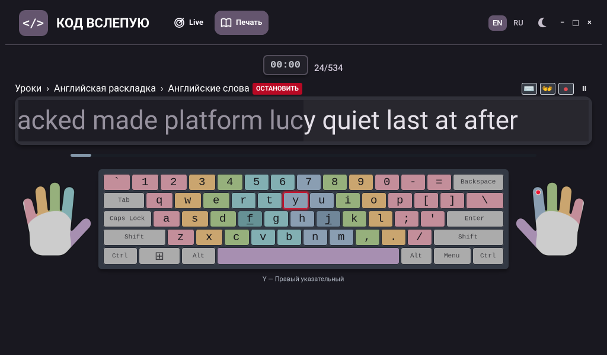
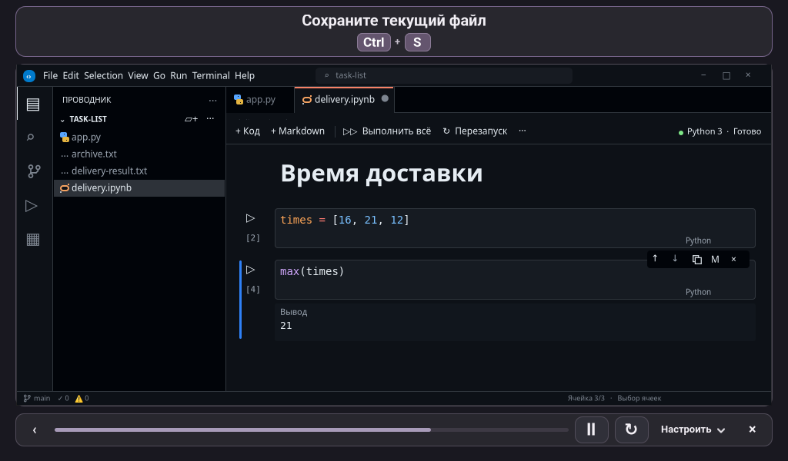

# Код вслепую

**Научитесь работать за компьютером без мыши, а не просто вспоминать названия клавиш.** В «Коде вслепую» вы можете набрать абзац, найти отчёт в загрузках, переименовать его и открыть в редакторе. У каждого действия виден результат: текст изменился, файл оказался в нужной папке, ячейка пересчиталась.

**[Скачать для Windows или Linux](https://github.com/veitnemed/touch_typing/releases/tag/v1.9.1)** · [Все выпуски](https://github.com/veitnemed/touch_typing/releases)

*Live в Linux-сборке. Ubuntu и Windows 10 здесь обозначают учебный рабочий стол: попробовать оба можно на одном компьютере.*

## Попробуйте один маршрут

Откройте **Live → Chrome → Настроить** и выберите **«Скачать CSV, переименовать и передать в проект»**. Найдите полученный файл в загрузках, откройте его папку, переименуйте файл клавишей `F2` и перенесите в проект. В конце вы откроете **тот же файл по новому пути** в учебном VS Code. Личные загрузки и документы останутся на месте.

Если не хочется выбирать поручение, просто нажмите на карточку приложения. В режиме с подсказками под целью появляется нужное сочетание. В самостоятельном режиме можно сначала попробовать по памяти. После штатной паузы и сохранения вернитесь к заданию через **«Продолжить»**.

## Два способа заниматься

### Печать: от строки текста до сочетания

Классическое занятие начинается с одного цикла на 350–550 символов без таймера. Выберите русские или английские слова, цифры и знаки либо смешанную практику: набрали текст, **нажали** `Ctrl+V` и продолжили печатать. Буквы «Ctrl+V», введённые по отдельности, сочетание не заменяют. Экранная клавиатура и подсказки для пальцев включаются по желанию.

*Печать в Linux-сборке, подсказки включены. После завершённой попытки с точностью ниже 98 % можно отдельно потренировать именно те знаки и сочетания, на которых вы ошиблись.*

### Live: клавиши в рабочем контексте

| Учебная среда | Что можно сделать |
| --- | --- |
| Chrome | Найти нужную вкладку, выделить адрес, сохранить закладку и вернуться к источнику через историю. |
| VS Code | Перейти от вызова к определению, переименовать символ, перенести файл в дереве проекта или исправить расчёт в ноутбуке. |
| Терминал и PowerShell | Прочитать журнал сбоя или проверить, на том ли диске не хватило места для архива. У консольных команд есть сворачиваемая теория: что покажет команда и зачем это смотреть. |
| Ubuntu и Windows 10 | Поставить два окна рядом, свернуть одно и вернуться к работе. Сочетания и поведение окон зависят от выбранной учебной системы. |
| Рабочий день | Взять значение у источника в одном приложении и перенести в нужное место отчёта в другом. |

*VS Code в Linux-сборке. Это симуляция: формулы поддерживаемого учебного набора пересчитываются в тренажёре. Устанавливать настоящий VS Code, Python или Jupyter для этого урока не нужно.*

## Установка

- **Windows x64:** на [странице выпуска](https://github.com/veitnemed/touch_typing/releases/tag/v1.9.1) скачайте архив `windows-x64.zip`, распакуйте **всю папку** и откройте `TouchTyping.exe`. Одного EXE недостаточно. [Инструкция для Windows](https://github.com/veitnemed/touch_typing/blob/v1.9.1/windows/README.md).
- **Ubuntu / Linux x64:** скачайте архив `linux-x64.tar.gz`, распакуйте и запустите из его папки `./install.sh`. В меню приложений появится **«Код вслепую — Linux»**. Без установки ярлыка можно открыть `./touch_typing.py`. Нужны Python 3, GTK 4, PyGObject и Cairo; среда .NET входит в архив. [Инструкция для Linux](https://github.com/veitnemed/touch_typing/blob/v1.9.1/linux/README.md).

Устанавливайте сборку **для системы на компьютере**. Какой рабочий стол тренировать, выберете уже внутри Live. Прогресс хранится локально в профиле пользователя, отдельно от распакованной папки.

Подробности для тех, кто хочет настроить занятия или собрать программу

- [Конечная и бесконечная печать](https://github.com/veitnemed/touch_typing/blob/v1.9.1/docs/CLASSIC_TYPING.md), [смешанный ввод](https://github.com/veitnemed/touch_typing/blob/v1.9.1/docs/TYPING_MIXED_INPUT.md), [работа над ошибками](https://github.com/veitnemed/touch_typing/blob/v1.9.1/docs/TYPING_MISTAKE_REVIEW.md).
- [Навигация по Live](https://github.com/veitnemed/touch_typing/blob/v1.9.1/docs/LIVE_COURSE_NAVIGATION.md), [учебные ноутбуки VS Code](https://github.com/veitnemed/touch_typing/blob/v1.9.1/docs/NOTEBOOK_WORKBENCH.md) и [терминальные задания](https://github.com/veitnemed/touch_typing/blob/v1.9.1/docs/TERMINAL_PRACTICE_CONTRACT.md).
- В Windows есть отдельный практикум **Start-Workday.cmd**, который использует настоящие окна и учебные файлы. Не путайте его с симуляциями в Live.
- [Сборка и проверки на Linux](https://github.com/veitnemed/touch_typing/blob/v1.9.1/linux/README.md) · [Сборка и проверки на Windows](https://github.com/veitnemed/touch_typing/blob/v1.9.1/windows/README.md) · [Правила участия](https://github.com/veitnemed/touch_typing/blob/v1.9.1/CONTRIBUTING.md).

