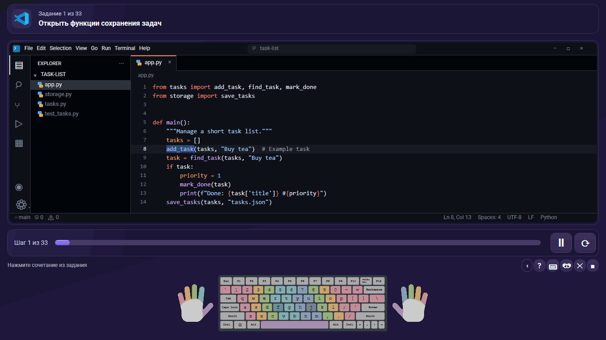
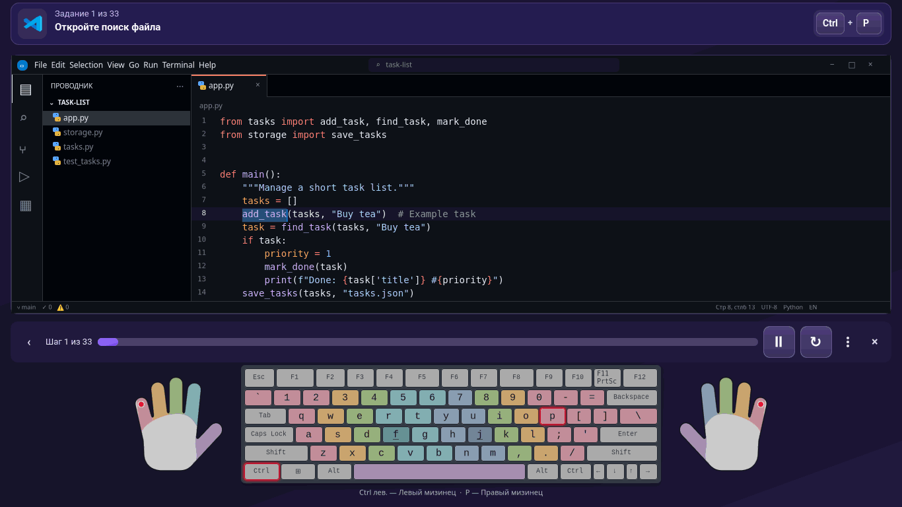

# Код вслепую · TouchTyping

Тренажёр слепой печати и горячих клавиш для Windows и Linux. Не просто запоминайте сочетания: найдите ошибку, исправьте нужную строку, сохраните файл и убедитесь, что задача зачтена.

## Скачать и попробовать

**Windows x64 · preview.7 beta**  
[Скачать ZIP для Windows](https://github.com/veitnemed/touch_typing/releases/download/v1.8.0-preview.7-windows-beta/touch-typing-v1.8.0-preview.7-windows-beta-x64.zip) · [Описание выпуска и SHA-256](https://github.com/veitnemed/touch_typing/releases/tag/v1.8.0-preview.7-windows-beta)

1. Распакуйте ZIP **целиком** в обычную папку.
2. Запустите `Start-Live.cmd`. Нужен .NET Framework 4.8 или новее.
3. В Live откройте класс **VS Code** и выберите упражнение на Python. Для практики в настоящих приложениях Windows есть отдельный запуск `Start-Workday.cmd`.

**Linux x86-64 · отдельный preview.7, без EXE**  
[Скачать архив для Linux](https://github.com/veitnemed/touch_typing/releases/download/v1.8.0-preview.7/touch-typing-v1.8.0-preview.7-linux-x64.tar.gz) · [Описание выпуска и SHA-256](https://github.com/veitnemed/touch_typing/releases/tag/v1.8.0-preview.7)

Распакуйте архив и выполните `bash install.sh` в распакованной папке. Нужны GTK 4, Python 3, PyGObject и Cairo. [Подробная установка для Linux](linux/README.md)

## Новое в preview.7: учебный редактор Python

Редактор в стиле GitHub Dark работает с отдельным учебным проектом, а не со своим исходным кодом. В заданиях можно искать текст, переходить между совпадениями, править и сохранять файл, открывать объявление через F12 и возвращаться к прежней позиции. Тренажёр проверяет сохранённую правку, а не только нажатия клавиш.

| Windows · WPF | Linux · GTK |
| --- | --- |
|  |  |

Скриншоты из запущенного приложения.

## Что ещё можно тренировать

- **Печать.** Русские и английские уроки, спецсимволы, свои тексты и Python. После занятия видны скорость, точность и частые промахи. Показ клавиатуры, рук и подсветки можно настроить отдельно.
- **Live.** Учебные сцены Ubuntu, Chrome, VS Code и терминала. Короткая тренировка на один приём или связанный маршрут «Рабочий день». Выбирайте «По шагам» или «Самостоятельно»; незавершённое занятие можно продолжить с сохранённого места.
- **Windows без мыши.** Отдельный курс в настоящих Проводнике, Блокноте и `cmd.exe`, а также в Chrome и VS Code, если они установлены. Вводный, обычный или сложный старт; задания используют учебные файлы. Подсказки можно отключить и вернуть по ходу работы.
- **Свои упражнения.** В «Редакторе» можно записать сочетание, добавить собственный текст и настроить подсказки для пальцев.

### Быстрые клавиши

| Клавиши | Действие |
| --- | --- |
| `Alt+1` / `Alt+2` / `Alt+3` / `Alt+4` | Live / печать / редактор / прогресс |
| `F5` или пробел · `F8` | Начать · пауза |
| `F10` в Live · `Esc` в печати | Завершить занятие и посмотреть результат |
| `Ctrl+Alt+F8` в курсе Windows | Скрыть или вернуть подсказки |

Лимит действий и таймер в Live настраиваются отдельно; можно заниматься без таймера. Перехват системных сочетаний действует только в активном учебном окне. Если система не передаёт нужную клавишу, занятие остаётся на паузе.

## Что проверено

- **Windows:** запуск этого ZIP штатным `Start-Live.cmd` на новом профиле в Windows Server 2025 x64, оба сценария Python и навигация в WPF. Домашняя Windows 10/11, в том числе 1366×768 при масштабировании 125% и 150%, ещё не подтверждена. Это бета для тестирования, не стабильный выпуск.
- **Linux:** редактор проверен в упакованном GTK-приложении в изолированном X11. На отдельном Linux-архиве проверена миссия поиска и возврат каретки под изолированным GNOME Wayland. Физическая клавиатура MateBook не проверялась.

Где лежит прогресс

Windows: `%LOCALAPPDATA%\TouchTypingStudio\progress.xml`. Учебные файлы курса «Windows без мыши»: `%LOCALAPPDATA%\TouchTypingStudio\DesktopPractice`.

Linux: `$XDG_DATA_HOME/TouchTypingStudio/progress.xml` или `~/.local/share/TouchTypingStudio/progress.xml`.

[Все релизы](https://github.com/veitnemed/touch_typing/releases) · [Документация Windows и Test-Live-UI.ps1](windows/README.md) · [Документация Linux и check.sh](linux/README.md) · [Сочетания VS Code](https://code.visualstudio.com/docs/reference/default-keybindings) · [Сочетания Windows](https://support.microsoft.com/en-us/accessibility/windows/keyboard-shortcuts-in-windows) · [Сочетания Chrome](https://support.google.com/chrome/answer/157179?hl=en)
