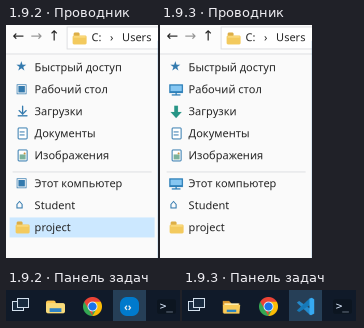
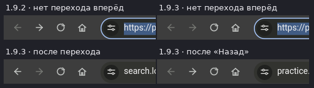
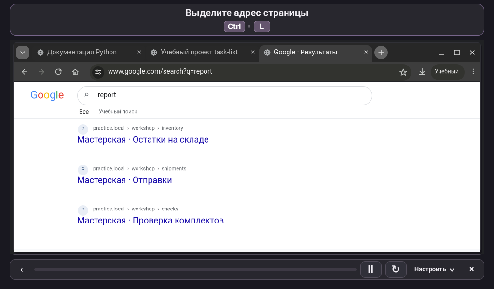

# Live: Проводник Windows 10 и Chrome

Сравнение с `v1.9.2` (`2da29df`). Речь о двух **учебных** окнах. Сценарии не обращаются к настоящей истории браузера, загрузкам или ФС пользователя.

### Проводник: родительская папка не должна выглядеть выбранным файлом

Из Live выберите Windows 10 → «Настроить» → «Windows 10: вернуться к папке проекта». Откройте Проводник, зайдите в `project/logs` и откройте `app.log`. В 1.9.2 слева в неактивном Проводнике синим был выделен ярлык `project`. Это неверная подсказка к заданию «Выберите project»: адрес окна заканчивается на `logs`, активен вообще редактор. Теперь закреплённый родитель не выделен; нейтральная подложка показывает текущую папку, синяя строка с контуром обозначает фактический выбранный объект в активной области списка.

Значки «Загрузки», компьютера, Проводника и редактора в профиле Windows не зависят от набора пиктограмм ОС. У развёрнутого окна две смещённые рамки восстановления; у обычного одна. В GTK проверен маршрут «развернуть → восстановить размер → вернуть Проводник → попасть в домашнюю папку → выбрать и открыть project»: `app.log` остаётся открыт.



### Chrome: направление стрелки соответствует возможному переходу

Из основной карточки Chrome откройте источник, введите поисковый запрос. На исходной странице без истории недоступны обе стрелки. На новой странице доступна «Назад», но не «Вперёд». После возврата «Вперёд» открывает именно посещённую страницу **той же вкладки**, а не запускает новый поиск. В 1.9.2 стрелка «Вперёд» была яркой даже в пустой истории, но не принимала клик.

Также работают «+», закрытие вкладки, перезагрузка, домашняя страница, добавление закладки и открытие списка загрузок. Закрытие фоновой вкладки не затирает набранный в адресной строке черновик и его каретку. Поворот истории и клики сохраняются в записи занятия, но **не дают зачёт** за требуемое сочетание. Последняя вкладка намеренно не закрывается крестиком вкладки: выход из занятия управляется отдельно. Меню профиля и расширений настоящего браузера не моделируются.



### На чём основано сравнение

- На полученном снимке настоящего Chrome 1920×1200: фон ряда вкладок `#272727`, панели `#3D3D3D`, поля адреса `#32332F`. Те же три заливки измерены на PNG работающего GTK-окна. Высота ряда вкладок в референсе 50 физических пикселей, в нашем компактном окне при 100% около 40. Не заявляем тождество разных масштабов.
- На фотографии пользовательского сценария Windows 10 видны `logs`, перекрывающий окно редактор с `app.log` и задача выбора `project`. Фотографии и настоящая история браузера **не входят** в репозиторий. PNG выше вырезаны без изменения масштаба из снимков нашего окна с одноразовыми учебными данными.
- Официальные ориентиры: [навигация в Проводнике](https://support.microsoft.com/en-gb/windows/experience/fileexplorer/file-explorer-in-windows), [переходы, вкладки и закладки Chrome](https://support.google.com/chrome/answer/157179), [форма и цвета значка Chrome](https://blog.google/products-and-platforms/products/chrome/how-we-redesigned-the-chrome-icon/).

### Воспроизводимая проверка

| Что | Доказательство этой разработки |
|---|---|
| Linux GTK, оба учебных профиля | Debian 13 x64, GTK/X11 в Xvfb, само окно 1024×600, 100%; настоящие XTest-события клавиатуры и указателя. В Проводнике прошли ошибочный путь, возврат и завершение. В обычной карточке Chrome прошли Back/Forward, неактивные границы, закладки, загрузки, домашняя, создание и закрытие вкладок; только физическая Ctrl+L зачтена как Ctrl+L. |
| Ранее заявленная проблема `handbook backup` | В том же стенде проверен именно вариант с seed=1: ввод в реальное поле истории, отбор строк без учёта регистра, открытие нужного раздела; отдельно мышью выбран результат и возвращён фокус поиска. |
| Движок | Протокольный тест на профилях Linux и Windows: история после перезапуска, активная вкладка, фокус, каретка, восстановление закрытой вкладки, отсутствие ложного зачёта. |
| WPF | Код приложения и независимый наблюдатель собраны компилятором C# с reference assemblies .NET Framework 4.8. Это **не** запуск Windows. В запуске Windows проверяется `windows/Test-Chrome-Surface.ps1` на упакованном EXE (адрес, вкладки, Back/Forward, нулевой зачёт мышью) и `windows/Test-Windows-Folder-Recovery.ps1` (ошибочный файл, максимизация, восстановление и завершение). Отдельно нужны результаты конкретного CI; физический ноутбук / 125–150% здесь не проверялись. |

Для повторения на изолированном графическом стенде соберите `linux/engine/TouchTyping.Engine.csproj`; задайте `TOUCH_TYPING_ENGINE` на полученный исполняемый файл, `PYTHONPATH=linux:linux/tests`, `TOUCH_TYPING_QA_DATA_ROOT` и `TOUCH_TYPING_QA_OUTPUT` на новые каталоги, `GDK_BACKEND=x11`. Для **каждого** теста используйте отдельный профиль. Не направляйте XTest в рабочий сеанс.

```sh
python3 -m unittest -v test_chrome_surface_pointer
xvfb-run -a python3 linux/tests/test_windows_folder_recovery_x11.py
xvfb-run -a python3 linux/tests/test_chrome_surface_x11.py
TOUCH_TYPING_QA_SEED=1 xvfb-run -a python3 linux/tests/test_chrome_history_native.py
TOUCH_TYPING_QA_SEED=1 xvfb-run -a python3 linux/tests/test_chrome_history_pointer_x11.py
```

Вход из карточки не подменялся сериализованным снимком сцены. Скрипты GTK запускают настоящий интерфейс с инструментами наблюдения, а не финальный Linux-архив; отдельный запуск кандидата из скачанного архива остаётся проверкой выпуска.

### Отдельный прогон обычного архива: поиск с основной карточки

Проверка реального входа обнаружила отличие от специального задания: в обычном Chrome запрос `report` показывал заглушку `search.local` и одинаковые ссылки даже на новой вкладке. Теперь Chrome из **основной** карточки использует тот же автономный экран поиска. Он ищет только по существующим материалам курса. Можно открыть найденный документ мышью или с клавиатуры, вернуться к выдаче с сохранённым выбором и повторить переход. Неизвестный запрос даёт пустую выдачу, а не подходящие для другого случая ссылки. Это не настоящий интернет-поиск. Результаты специально подготовленных миссий и их порядок не заменялись.



Собрали `linux/build-release.sh`, упаковали, распаковали в чистую папку. На Debian 13 x64/X11 запустили `./touch_typing.py` без QA-флагов, без подмены движка и без импорта Python-кода приложения в проверяющий процесс. На чистом профиле нажали карточку Chrome, «+», ввели `report`. На экране три результата: остатки, отправки, проверка комплектов. Открыли мышью «Отправки»: адрес изменился на `/workshop/shipments`; «Назад» показала прежний запрос и выделила посещённую строку; «Вперёд» снова открыла «Отправки». Эти клики не закрыли шаг на Ctrl+L. Ctrl+L на чужой вкладке выделил её адрес, но не засчитал задание на исходную вкладку; отдельный прогон вернулся в исходный документ и там проверил зачёт физического Ctrl+L. Кадр выше получен захватом окна этого процесса.

Фикстура `qa/fixtures/chrome-ordinary-query-v1.9.2.xml` создана нетронутым движком релизного тега с тестовыми данными. При обновлении старое занятие сохраняет прежний URL и задание; **следующий** запрос использует новую выдачу, которая восстанавливается и после второго перезапуска. Архив этого прогона — локальный кандидат для визуальной проверки, не опубликованный или финальный релиз.
